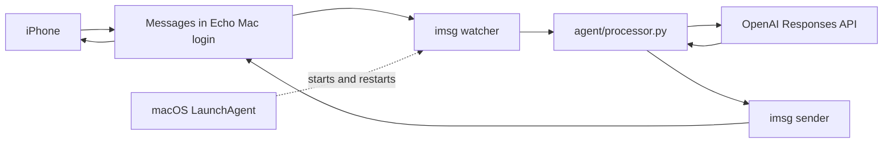

# Echo — an always-available iMessage assistant

## Repair background Messages access

If the bot repeatedly exits with “Messages access failed”, pull the latest code
and **double-click `Repair Echo.command` in Finder**, inside the Echo Mac login.
It opens Full Disk Access settings and selects the actual Python executable in
Finder. Add it with the + button and enable its switch, then return to the repair
window and press Enter. The tool migrates older keep-awake wrappers to a direct
Python launcher, preserves your recipient/settings, restarts Echo, and checks
for a fresh startup acknowledgement. Sleep prevention runs as a Python child.

macOS requires you to authorize Full Disk Access yourself; the tool cannot grant
it. If startup still fails, it opens the error log and selects imsg for the next
permission check. Terminal permissions alone may not cover background jobs.
After startup succeeds, send a phone message to verify actual delivery and any
separate Messages Automation permission. The repair tool doesn't read or copy
chat contents or change your API key.


Echo runs in its own macOS login, signed into Messages with a separate Apple
Account. Your iPhone messages that account's email. Only one selected conversation
is watched. No BlueBubbles, public HTTP server, or port forwarding is required for
the recommended direct Mac mode.



`agent/processor.py` owns all reply generation. It calls OpenAI using
`gpt-4.1-mini` by default, configurable with `OPENAI_MODEL`. Each message is
independent: no memory, database, web browsing, computer tools, or scheduled tasks.
The message text is sent to OpenAI; the sender identifier is not. Requests set
`store=False` (this is not a promise of zero provider retention). API usage is
billed separately from a ChatGPT subscription. Dry runs still call OpenAI.

## What happens when you switch users?

| Mac state | Echo behavior |
| --- | --- |
| Switch to your main login | Echo's processes keep running in its logged-in session |
| Lock screen or turn display off | Can keep running if the computer remains awake |
| Quit the terminal after activating LaunchAgent | Background service remains running |
| Bot exits | LaunchAgent restarts it, with a 30-second launch throttle |
| Log Echo out | Bot stops until Echo logs in again |
| Restart / power loss | Log into Echo again to start its LaunchAgent |
| Sleep / closed laptop lid / no internet | Cannot respond reliably until awake and connected |

Use **Fast User Switching**, not Log Out. Keep the Mac plugged in, online, and
configured to prevent automatic system sleep when the display is off. Display
sleep is fine. Do not rely on a closed laptop lid keeping the Mac awake.
Apple documents that switched-out processes continue running, but Messages
permissions and delivery must be tested in your actual switched-out session.

## Setup in the Echo macOS login

1. Create a separate Standard macOS user called Echo. In that login, sign into
   Messages with the separate Apple Account. From your iPhone, text Echo's email
   and manually reply from the Mac to establish a working conversation.
2. Copy this project into that user's home, for example `~/echo`. Transfer the
   source files (including the hidden `.env.example`), not `.venv` or a real `.env`.
   Create a fresh environment there:

```sh
cd ~/echo
python3 -m venv .venv
.venv/bin/python -m pip install -r requirements.txt
cp .env.example .env
chmod 600 .env
```

3. Edit `.env` locally and set `OPENAI_API_KEY` to your OpenAI API key. Do not paste
   it into chat or commit it. BlueBubbles settings are unused in direct mode.
4. Install `imsg` if needed: `brew install steipete/tap/imsg`. It is already
   installed on the original Mac. In this login, give your terminal Full Disk
   Access, reopen it, and allow control of Messages when prompted.
5. Test the processor alone (uses the API but sends no iMessages):

```sh
.venv/bin/python -m agent.processor "Tell me a short joke"
```

6. Start the foreground bot, replacing the example number with your own iPhone's
   iMessage number or email exactly as listed by `imsg chats --json`:

```sh
.venv/bin/python run_echo.py --send --to +15551234567
```

Send a new message from the iPhone to **Echo's email**. Only the selected incoming
conversation can trigger replies. Stop this foreground bot with Ctrl+C before
activating the background service. Do not run two copies.

## Activate background operation

After copying the latest source to Echo's login, configuring `.env`, installing
requirements, and passing the foreground test, a single command installs both
services and prevents idle system sleep:

```sh
.venv/bin/python service.py --to +19089691989 --auto-update --keep-awake --install
```

This command uses the configured owner’s iPhone number; replace `--to` if deploying for someone else.
Run this as the Echo macOS user, without sudo. Stop any foreground bot first.
The installer replaces an existing loaded Echo service. `--keep-awake` uses
`caffeinate -i` only while the bot runs; it allows display sleep and does not
prevent manually requested sleep or guarantee operation with a closed lid.
Without `--install`, the script only generates configuration files. Automatic
updates need a clean Git clone with published code on `origin/main`. A local
copy with uncommitted source can run the bot but cannot automatically update.
The installer loading successfully does not confirm Messages permissions or
remote delivery; test from the phone after switching to your main Mac login.


Run these in the **Echo login**, from the copied project directory, after the
foreground test succeeds. The generator creates a plist with this user's absolute
paths and the selected recipient. It does not start anything by itself.

```sh
.venv/bin/python service.py --to +15551234567
mkdir -p ~/Library/LaunchAgents
cp local.echo.bot.plist ~/Library/LaunchAgents/
launchctl bootstrap "gui/$(id -u)" ~/Library/LaunchAgents/local.echo.bot.plist
```

The LaunchAgent starts at login and restarts after exit. It runs in Echo's GUI
session, not as a root daemon. It reads the API key from the project's `.env`;
the key is not embedded in the plist.

**Permissions are tied to the launcher.** A successful terminal test does not
prove launchd has access. Check the service logs. If macOS denies access, the
background executable may require its own Full Disk Access / Messages Automation
authorization in the Echo login. Approve through System Settings; no SIP changes
are needed. If a background permission prompt cannot be completed, stop the
service and use the working terminal instance while resolving permissions.

Test a new phone message while in Echo, then **Switch User** to your main login
and test again. Only after both work is background delivery verified.

Inspect status and logs from Echo's login:

```sh
launchctl print "gui/$(id -u)/local.echo.bot"
tail -n 40 ~/Library/Logs/Echo/stderr.log
```

Stop the service:

```sh
launchctl bootout "gui/$(id -u)" ~/Library/LaunchAgents/local.echo.bot.plist
```

To disable future login starts, move that plist out of `~/Library/LaunchAgents`.
To apply code/config changes, boot out then bootstrap again. Logs are local;
application errors omit message text and raw API error details. The underlying
imsg command may print its own diagnostics. Log rotation is not configured.

## Reliability boundaries

This is a small supervised message bot, not a durable job system. It watches new
messages only; messages received while stopped, restarting, or offline are not
replayed. A failed request stops that run; launchd starts a fresh watcher.
OpenAI has a 30-second request timeout and at most one SDK retry. iMessage sends
have a 45-second timeout and are never retried automatically, since delivery
may already have happened. No exactly-once delivery guarantee. A local send
confirmation does not prove delivery to the phone.

The AI runs only when a message arrives. It does not continuously think, monitor
your apps, or proactively schedule work. For now replies have no conversation
history, and restarting loses no agent memory because none is stored.

## Extending Echo

There are three places to work:

- **Agent behavior:** edit `agent/processor.py`. Its interface stays
  `process_message(message, sender) -> str`; return an empty string to skip a reply.
  Add memory or tools here without changing the launchers or transports.
- **Messaging:** `messaging/imsg_transport.py` separates watching, handling an event,
  and sending a reply. `send_reply` owns send confirmation and error handling.
  The optional BlueBubbles adapter uses the same processor interface.
- **Background operation:** `service.py` builds both job configurations through
  `build_plist`; `update_bot.py` owns the Git update workflow.

`run_echo.py` owns all CLI options and conversation selection. Both existing
entry points remain supported, and no framework or plugin registry is needed.

## Files and tests

- `run_echo.py`: selects one direct conversation by recipient or interactive picker.
- `imsg_main.py`: compatibility entry point for `run_echo.py --chat-id`; no duplicated launcher logic.
- `messaging/imsg_transport.py`: receives events, filters, calls processor, sends.
- `agent/processor.py`: OpenAI instructions and reply generation only.
- `service.py`: creates a per-user LaunchAgent configuration.
- `main.py`, `messaging/receiver.py`, `messaging/sender.py`: optional Flask/BlueBubbles mode.

```sh
.venv/bin/python -m unittest discover -s tests -v
```

Tests mock OpenAI and messaging calls: no API costs or actual iMessages.
A live API test requires a configured key and model access.

Same-account testing is still supported with `--self-chat`: only outgoing
`/echo hello` commands trigger it, and incoming self-copies are ignored. Apple's
duplicate sent/received bubbles in self conversations remain normal behavior.
Use separate accounts for the distinct Echo contact experience.

## Optional BlueBubbles mode

Install BlueBubbles Server on the Mac, sign into Messages, grant required Full
Disk Access and Automation permissions, and configure its server password.
Set `BLUEBUBBLES_URL`, `BLUEBUBBLES_PASSWORD`, and `OPENAI_API_KEY` in `.env`, then
run `.venv/bin/python main.py`. Configure a BlueBubbles `new-message` webhook to
`http://127.0.0.1:8000/webhook`. Basic sends use `apple-script` without Private API.

This optional webhook mode responds to all incoming text, including group chats;
it does not use the direct mode's single-chat selection. Keep the unauthenticated
endpoint on loopback. It does not deduplicate webhook deliveries. Do not run both
transports against the same conversation. The LaunchAgent above runs direct mode.

## Sources

- [OpenAI Responses API](https://developers.openai.com/api/reference/python/resources/responses/methods/create)
- [GPT-4.1 mini](https://developers.openai.com/api/docs/models/gpt-4.1-mini)
- [Apple: Fast User Switching](https://developer.apple.com/library/archive/documentation/MacOSX/Conceptual/BPMultipleUsers/Concepts/FastUserSwitching.html)
- macOS local `launchd.plist` manual: RunAtLoad, KeepAlive, ThrottleInterval, Aqua session.
- [imsg installation](https://github.com/openclaw/imsg/blob/main/docs/install.md)
- [imsg watch](https://github.com/openclaw/imsg/blob/main/docs/watch.md)
- [imsg send](https://github.com/openclaw/imsg/blob/main/docs/send.md)

## Verified BlueBubbles API contract


Checked against the official documentation and server source on October 15, 2026, at server commit `f2e2286241a7c3b6617a82b37d4afaab4df3a6b9`.

A minimal incoming event has this shape (BlueBubbles includes additional fields):

```json
{
  "type": "new-message",
  "data": {
    "guid": "incoming-message-guid",
    "text": "Hello",
    "isFromMe": false,
    "handle": {"address": "+15551234567"},
    "chats": [{"guid": "iMessage;-;+15551234567"}]
  }
}
```

The sender posts to `/api/v1/message/text` with the server password in the `password` query parameter and JSON containing `chatGuid`, `message`, `method`, and a generated `tempGuid`. It uses the incoming chat GUID unchanged, so replies target the original conversation.

**Documentation discrepancy:** the older official Python webhook example uses `text` in the outbound JSON. The current server validator and router require `message`, and AppleScript sends also require `tempGuid`. This project follows the current implementation.

Sources:

- [Official REST API and webhook guide](https://docs.bluebubbles.app/server/developer-guides/rest-api-and-webhooks) and its [linked Postman API reference](https://documenter.getpostman.com/view/765844/UV5RnfwM).
- [Official webhook setup](https://docs.bluebubbles.app/server/developer-guides/simple-web-server-for-webhooks) and [Python webhook example](https://docs.bluebubbles.app/server/developer-guides/simple-web-server-for-webhooks/python-web-server).
- [Current send validation](https://github.com/BlueBubblesApp/bluebubbles-server/blob/f2e2286241a7c3b6617a82b37d4afaab4df3a6b9/packages/server/src/server/api/http/api/v1/validators/messageValidator.ts) and [send handler](https://github.com/BlueBubblesApp/bluebubbles-server/blob/f2e2286241a7c3b6617a82b37d4afaab4df3a6b9/packages/server/src/server/api/http/api/v1/routers/messageRouter.ts).
- [Message serialization](https://github.com/BlueBubblesApp/bluebubbles-server/blob/f2e2286241a7c3b6617a82b37d4afaab4df3a6b9/packages/server/src/server/api/serializers/MessageSerializer.ts), [sender-address serialization](https://github.com/BlueBubblesApp/bluebubbles-server/blob/f2e2286241a7c3b6617a82b37d4afaab4df3a6b9/packages/server/src/server/api/serializers/HandleSerializer.ts), and [webhook dispatch](https://github.com/BlueBubblesApp/bluebubbles-server/blob/f2e2286241a7c3b6617a82b37d4afaab4df3a6b9/packages/server/src/server/services/webhookService/index.ts).

## Automatic GitHub updates

Updates follow code committed and pushed to `origin/main`. Keep `.env` private.
Use a dedicated clean clone in the Echo login; develop elsewhere.

After the foreground test succeeds, generate both services:

```sh
.venv/bin/python service.py --to YOUR_IPHONE_NUMBER --auto-update
mkdir -p ~/Library/LaunchAgents
cp local.echo.bot.plist local.echo.update.plist ~/Library/LaunchAgents/
launchctl bootstrap "gui/$(id -u)" ~/Library/LaunchAgents/local.echo.bot.plist
launchctl bootstrap "gui/$(id -u)" ~/Library/LaunchAgents/local.echo.update.plist
```

If a service is already loaded, boot it out before bootstrapping its replacement.
GitHub access must work without an interactive password prompt in the Echo login.
The updater checks `origin/main` every five minutes, skips dirty/non-main checkouts,
requires a fast-forward, installs dependencies and runs tests in an isolated Git
worktree, then installs dependencies in the live environment, fast-forwards, and
restarts the bot. It never stashes or resets local edits. It follows the configured
origin URL, so use only your trusted repository. Tests in fetched code execute as
Echo. Changes to service configuration require regenerating/reloading the plists.

This is not an atomic deployment or zero-downtime service. Dependency-install or
restart errors require checking `~/Library/Logs/Echo/update.log`; a partially failed
live dependency install can require manual repair. Restarting interrupts an
in-flight reply and the watcher has no offline replay. A candidate test failure
leaves the live source and environment unchanged. Do not manually edit the runtime
checkout during deployment. Logs are not automatically rotated.

Stop auto-updates with:

```sh
launchctl bootout "gui/$(id -u)" ~/Library/LaunchAgents/local.echo.update.plist
```

Move its plist outside `~/Library/LaunchAgents` to disable it at future logins.

## Deployment history on GitHub

`deployment_log.py` writes an append-only local journal at
`~/Library/Logs/Echo/events.jsonl`. Each entry has a UTC timestamp and an event:

- `update_detected`: polling discovered a new `main` commit, with old/new hashes.
  This is when the Mac noticed the push, not GitHub's exact push timestamp.
- `restart_requested`: the updater installed the code and requested a restart.
- `watcher_starting`: a send-enabled bot is launching its Messages watcher.
- `watcher_started`: the watcher survived its first two seconds; includes commit,
  process ID, and a unique run ID. Foreground send-enabled runs are recorded too.
- `update_started`: the updater observed a fresh startup acknowledgement for the
  expected commit and verified the Python process was still alive.
- `update_failed`: updating or waiting for startup failed; only the error type is logged.

Startup acknowledgement is not a full health check: it does not prove OpenAI
access, sending permission, or remote message delivery. Test those with a message.
If the watcher doesn't acknowledge within 30 seconds, the update is logged as
failed instead of claiming a successful restart.

After each updater run (including no-change checks), it publishes the accumulated
journal to **`deployment-logs`**, under `logs/<instance-id>.jsonl`. Each Mac login
gets a random persistent ID. This separate branch prevents logging commits from
triggering a deployment loop on `main`, and publishing never edits the running
checkout. Only lifecycle metadata is uploaded: no API keys, message text, email
addresses, or phone numbers. No commit is created when the journal is unchanged.

The Echo login needs noninteractive GitHub **write access**, not just pull access.
Rejected or offline uploads retain the local journal and retry on the next
five-minute check. Concurrent pushes are not forced; a rejected push is retried
against the newest branch on the next check. Ordinary restarts are therefore
published within the next check; an updater-triggered restart is published after
startup acknowledgement. The branch first appears after a successful real upload.

View [deployment logs](https://github.com/nirvaankohli/echo/tree/deployment-logs/logs)
on GitHub, or locally:

```sh
tail -f ~/Library/Logs/Echo/events.jsonl
```

Keep the existing background bot and updater installed. This feature does not
require new plist settings; once this code is deployed, send-enabled runs record
startup events automatically. Local logs are not automatically rotated.

## Messages arrive but Echo stays silent

Double-click `Diagnose Echo.command` in the Echo project folder. It reads the
installed bot's conversation selection and tests the last five rows through the
real message filter, with OpenAI replaced by a fake processor and sending disabled.
It displays direction, chat-format category, and skip reasons, never message text,
recipient addresses, or API keys. Its results distinguish rejected rows from rows
that the filter would accept; it does not verify live watcher delivery or OpenAI.
If diagnosis itself lacks Messages access, grant its launcher the usual permission.
Normal bot logs now also show accepted messages, skipped-message reasons, and when
the agent responds. These diagnostics are local, not uploaded as deployment events.

### Service-neutral direct conversations

macOS may label a direct conversation `any;-;recipient` even when the launcher
lists it as iMessage. Both normal incoming mode and self-chat mode support this
format. The GUID must match the nonempty chat identifier, the event must belong
to the selected chat, and group events are rejected. Replies target that exact
identifier with iMessage explicitly selected and SMS fallback disabled. Normal
mode still ignores outgoing messages; self-chat mode still requires `/echo`.
